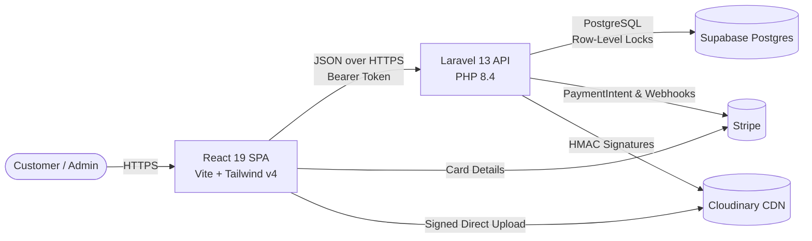
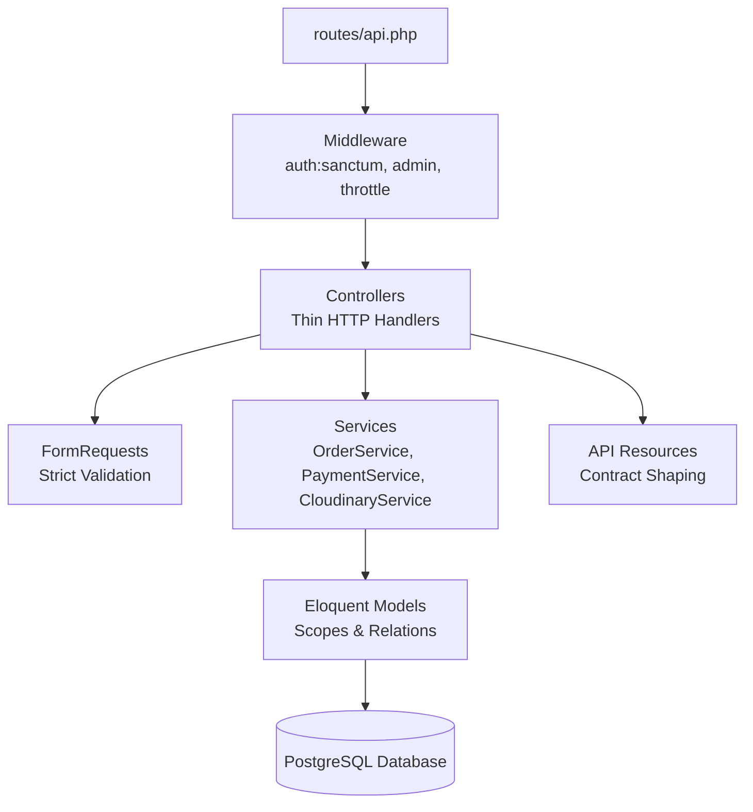

# ⚓ TrueHarbor

> **A high-design, engineering-first coastal commerce platform built with Laravel 13, PostgreSQL, React 19, and Tailwind CSS v4.**

TrueHarbor is a modern full-stack ecommerce application crafted to showcase rigorous engineering standards and refined design aesthetics. Designed around coastal lifestyle utility and archival goods, the platform demonstrates correct handling of monetary precision, concurrency-safe inventory reservation, PCI-compliant payments, direct CDN media pipelines, and dynamic accessible theming.

---

## 🌟 Core Engineering Highlights

- **Integer-Cents Monetary Precision**: All monetary values (`price_cents`, `subtotal_cents`, `shipping_cents`, `total_cents`) are stored and computed strictly as 64-bit integers in Philippine Centavos (₱). Floats are strictly prohibited in calculation logic to eliminate floating-point rounding errors.
- **Atomic Concurrency & Row-Level Locking**: Checkout transactions execute within database transactions utilizing PostgreSQL row-level locks (`SELECT ... FOR UPDATE`). Items are reserved with verified stock checks, preventing overselling or race conditions under high concurrent demand.
- **Zero Raw-Card Footprint (Stripe Elements)**: Card credentials flow directly from the browser to Stripe via Stripe.js. The backend only ever handles signed `PaymentIntent` tokens and verifies events using cryptographically signed webhooks.
- **Direct-to-CDN Media Architecture (Cloudinary)**: Product gallery uploads generate secure server-signed HMAC signatures (`/api/admin/media/signature`), enabling the browser to stream assets directly to Cloudinary without bottlenecking the application server.
- **Midnight Harbor Theming**: Full dark mode engineered with tailored HSL tokens, persistent user preference, and system OS detection, achieving 100% WCAG AAA contrast across both daylight and midnight states.
- **Quarterdeck Admin Operations**: Built-in back office with live telemetry, fulfillment queue processing, stock alert thresholds, order status progression, and multi-angle product photography management.

---

## 🏛 System Architecture

### High-Level Topology



### Backend Layered Architecture



---

## 🚀 Quick Start Guide

### Prerequisites
- **PHP**: `^8.4` (with `pdo_pgsql`, `curl`, `mbstring`, `openssl`)
- **Composer**: `^2.x`
- **Node.js**: `^20.x` or `^22.x`
- **PostgreSQL**: `^15.x` (or Supabase instance)

---

### 1. Backend Setup

```bash
cd Backend

# Install PHP dependencies
composer install

# Configure environment
cp .env.example .env
php artisan key:generate

# Run database migrations and seeders
php artisan migrate --seed

# Start the Laravel development server (runs on port 8000)
php artisan serve
```

### 2. Frontend Setup

```bash
cd Frontend

# Install Node dependencies
npm install

# Start the Vite development server (runs on port 5173)
npm run dev
```

---

## 🚢 Deployment on Render (Unified Docker Container)

TrueHarbor includes a production multi-stage [`Dockerfile`](file:///c:/TrueHarbor/Dockerfile) that bundles both the React 19 Frontend and Laravel 13 Backend into a **single unified container** served by Nginx and PHP-FPM.

### One-Click Blueprint Setup:
1. Push your repository to GitHub.
2. In the [Render Dashboard](https://dashboard.render.com), click **New +** → **Blueprint**.
3. Select this repository. Render automatically reads [`render.yaml`](file:///c:/TrueHarbor/render.yaml).
4. Fill in your environment secrets (`DB_HOST`, `DB_PASSWORD`, `CLOUDINARY_*`, `STRIPE_*`).
5. Click **Apply**. Render will automatically build the React app, configure Laravel, run database migrations, and deploy to a live HTTPS URL (e.g. `https://trueharbor.onrender.com`).

### Manual Web Service Setup:
1. Click **New +** → **Web Service**.
2. Connect your GitHub repository.
3. Select **Docker** environment (Render auto-detects root `Dockerfile`).
4. Add your environment variables from the table below.
5. Deploy!

---

## 🔑 Environment Configuration

Key configuration parameters inside [`Backend/.env`](file:///c:/TrueHarbor/Backend/.env):

```env
APP_NAME=TrueHarbor
APP_ENV=local
APP_URL=http://localhost:8000

# PostgreSQL Database (e.g. Supabase or Local)
DB_CONNECTION=pgsql
DB_HOST=your-db-host.supabase.com
DB_PORT=5432
DB_DATABASE=postgres
DB_USERNAME=your-username
DB_PASSWORD=your-password

# Stripe Payments (Test Mode)
STRIPE_KEY=pk_test_...
STRIPE_SECRET=sk_test_...
STRIPE_WEBHOOK_SECRET=whsec_...

# Cloudinary CDN Media Storage
CLOUDINARY_CLOUD_NAME=your_cloud_name
CLOUDINARY_API_KEY=your_api_key
CLOUDINARY_API_SECRET=your_api_secret
```

---

## 👤 Demo Credentials

TrueHarbor seed data provides pre-configured test users ready for review:

| Role | Email | Password | Access Level |
|---|---|---|---|
| **Administrator** | `admin@trueharbor.test` | `password` | Quarterdeck Operations (`/admin`), inventory, fulfillment, media |
| **Customer** | `customer@trueharbor.test` | `password` | Storefront catalog, cart, checkout, order history |

---

## 📦 Project Structure

```
TrueHarbor/
├── Backend/                    # Laravel 13 REST API
│   ├── app/
│   │   ├── Http/
│   │   │   ├── Controllers/    # Thin HTTP controllers (Storefront & Admin)
│   │   │   └── Resources/      # JSON API response transformers
│   │   ├── Models/             # Product, Order, OrderItem, User, ProductImage
│   │   └── Services/           # CloudinaryService, Payment, Concurrency
│   ├── database/
│   │   ├── migrations/         # PostgreSQL schema definitions
│   │   └── seeders/            # Catalog, Category, and Admin user seeders
│   └── tests/                  # PHPUnit test suites (46 tests, 252 assertions)
│
├── Frontend/                   # React 19 + TypeScript + Vite SPA
│   ├── public/                 # Static assets, SVG marks, placeholders
│   └── src/
│       ├── api/                # Axios API client contracts (Auth, Catalog, Cart, Admin)
│       ├── components/         # Reusable UI components (ProductCard, Navbar, Footer)
│       ├── context/            # AuthContext, ThemeContext, CartContext, ToastContext
│       ├── pages/              # HomePage, CatalogPage, ProductDetailPage, CartPage, AdminDashboard
│       └── styles/             # tokens.css (Design tokens) & index.css (Tailwind v4 theme)
│
└── docs/                       # Project documentation
    ├── PRD.md                  # Product Requirements Document
    ├── TRD.md                  # Technical Requirements Document
    ├── DESIGN.md               # Design System and UI Token Specifications
    └── architecture.md         # Architecture diagrams & component topology
```

---

## 🛠 Available Commands

### Backend (`Backend/`)

| Command | Description |
|---|---|
| `php artisan serve` | Starts the local API server on `http://127.0.0.1:8000` |
| `php artisan test` | Runs the full PHPUnit test suite (46 tests, 252 assertions) |
| `php artisan migrate:fresh --seed` | Rebuilds database tables and seeds catalog and admin data |
| `php artisan config:clear` | Clears compiled configuration caches |

### Frontend (`Frontend/`)

| Command | Description |
|---|---|
| `npm run dev` | Starts Vite dev server with Hot Module Replacement on `http://localhost:5173` |
| `npm run build` | Compiles TypeScript and builds optimized production assets |
| `npm run lint` | Runs ESLint verification across frontend code |

---

## 📐 Architectural Decisions (ADRs)

1. **[ADR-001] Integer Centavos for Monetary Amounts**:
   - *Decision*: Store currency as integer cents (e.g. `₱1,299.00` = `129900`).
   - *Rationale*: Floating-point arithmetic introduces IEEE 754 precision drift across calculations and round-trips.
2. **[ADR-002] Direct-to-Provider Media Uploads**:
   - *Decision*: Browser uploads directly to Cloudinary using HMAC signatures generated by Laravel.
   - *Rationale*: Prevents large binary payloads from blocking synchronous PHP-FPM / Artisan worker threads.
3. **[ADR-003] Row-Level Concurrency Control**:
   - *Decision*: Enforce `lockForUpdate()` on product stock records inside database transactions during checkout.
   - *Rationale*: Guarantees atomic inventory deduction even when multiple customers purchase the final unit concurrently.
4. **[ADR-004] CSS Token Inversion Protection**:
   - *Decision*: Do not override `--color-white` in Tailwind `@theme`. Map dark card surfaces to `--color-card` while preserving pure `#ffffff` text contrast.
   - *Rationale*: Avoids breaking native utility classes like `text-white` in dark theme mode.

---

## 📄 License & Attribution

- Built as an engineering showcase project for **TrueHarbor Coastal Goods**.
- Photography assets courtesy of Unsplash & Wikimedia Commons coastal archives.
