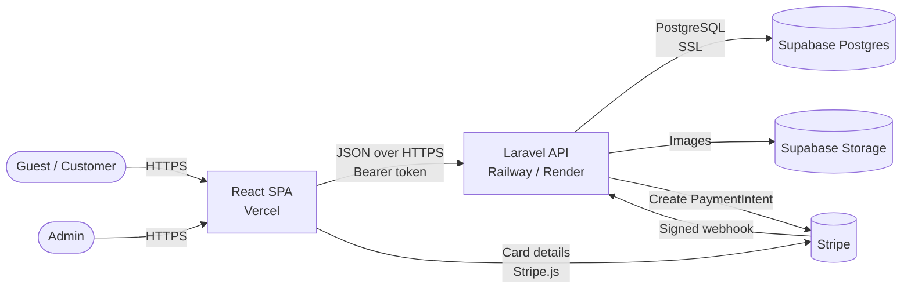
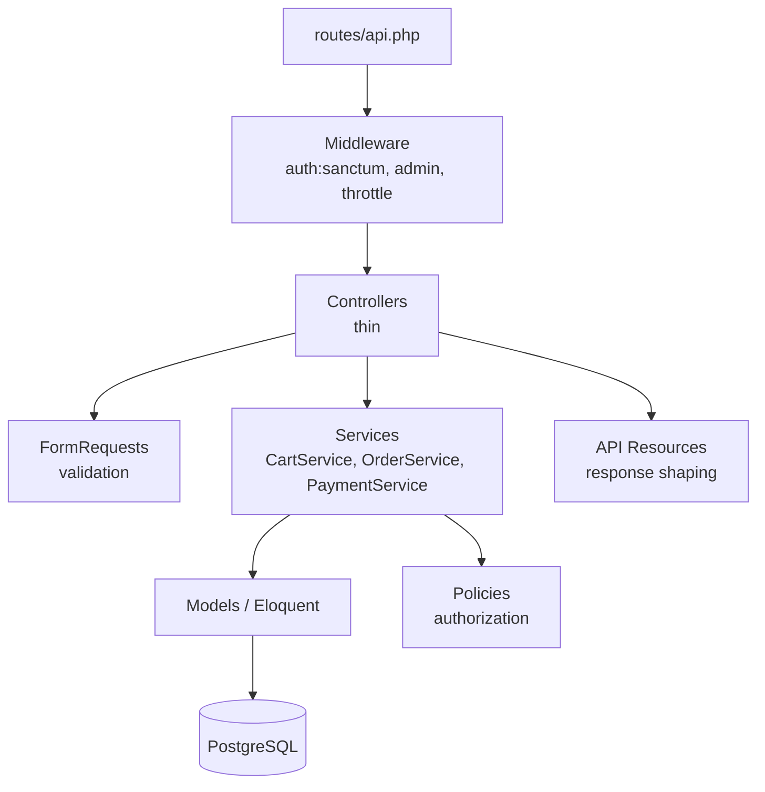
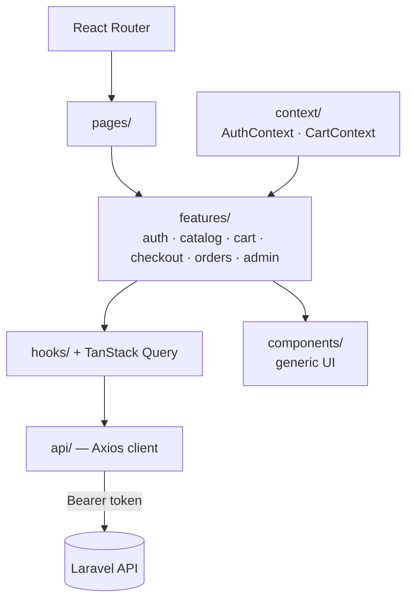
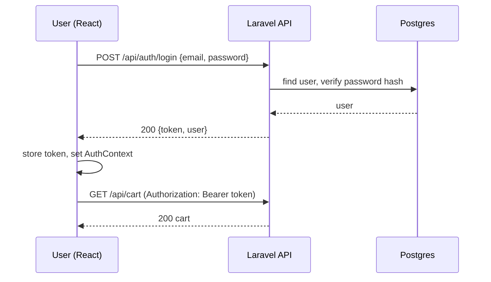
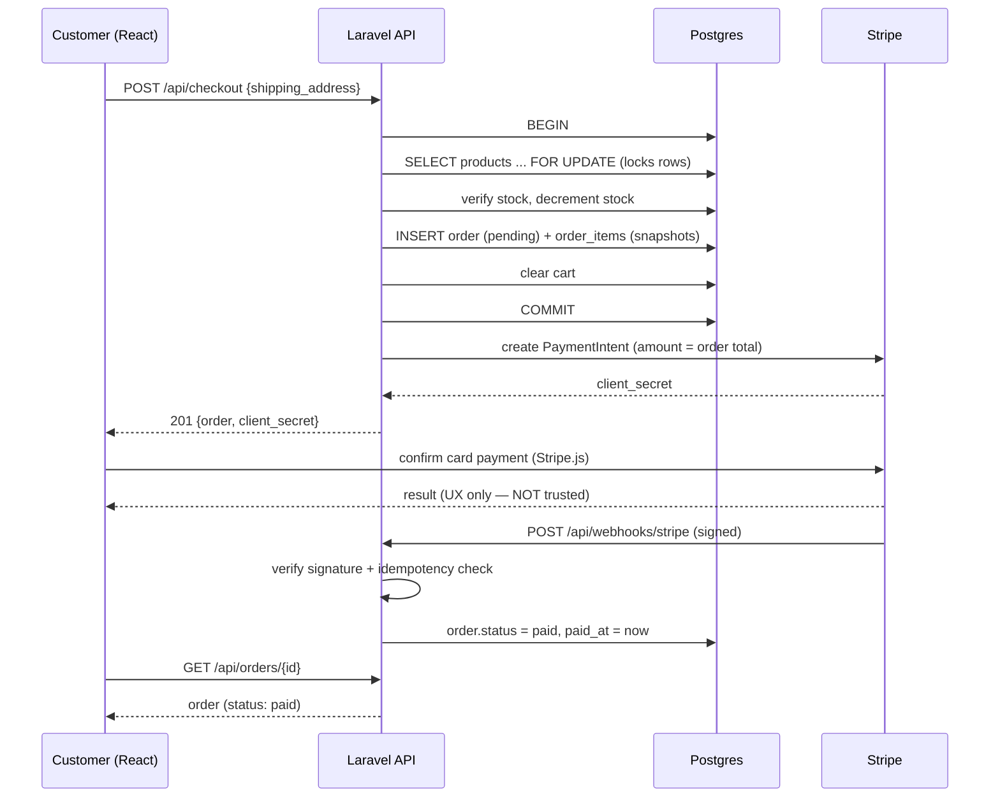
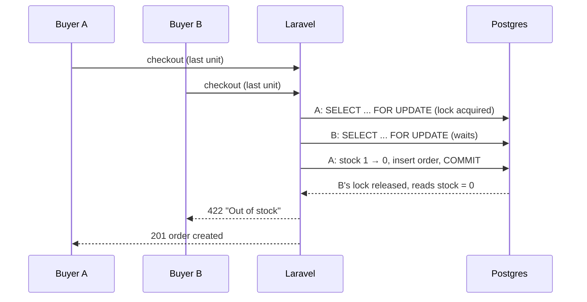
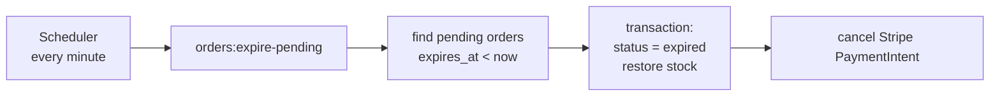
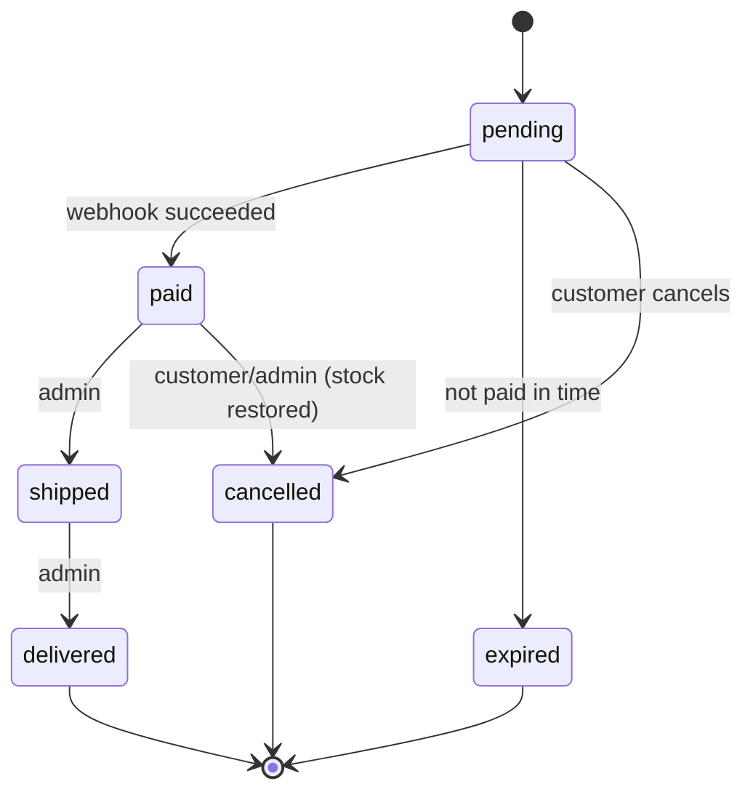
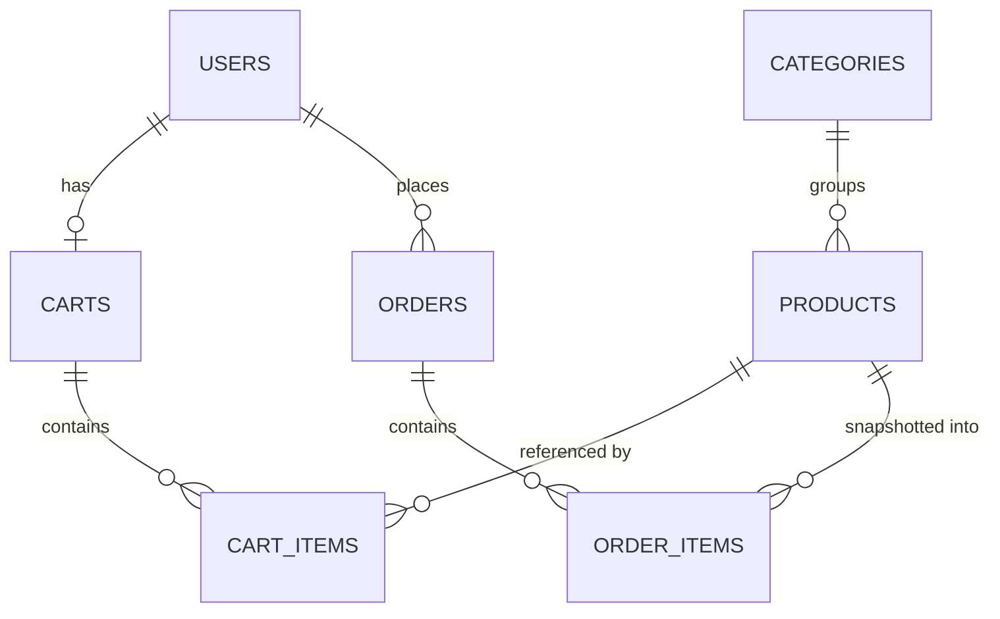
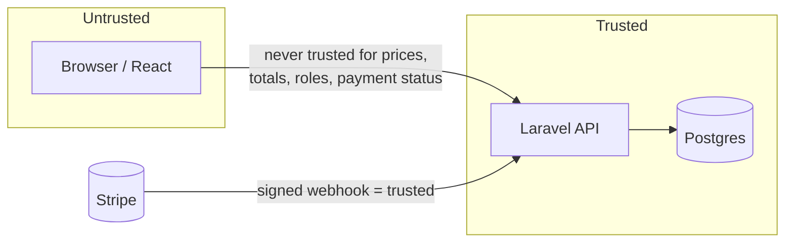

# TrueHarbor — Architecture

| | |
|---|---|
| **Version** | 1.0 (Draft) |
| **Companion docs** | [PRD.md](./PRD.md) · [TRD.md](./TRD.md) · [api.md](./api.md) |

> **Purpose of this document:** a visual and conceptual map of how the pieces fit together and how data flows through them. For schema, rules, and rationale in detail, see the TRD.

---

## 1. System Context



**Key idea:** card details go from the browser **directly to Stripe**. Our servers only ever see a PaymentIntent id and the webhook result, so we never handle raw card data.

## 2. Containers (Deployable Units)

| Container | Tech | Responsibility | Hosted on |
|---|---|---|---|
| **Frontend** | React + Vite | UI, routing, calls the API, hosts Stripe Elements | Vercel |
| **Backend** | Laravel 11 | Business rules, auth, orders, webhooks, scheduler | Railway / Render |
| **Database** | Supabase Postgres | Persistent relational data | Supabase |
| **Object storage** | Supabase Storage | Product images | Supabase |
| **Payments** | Stripe (test mode) | Card processing | Stripe |

## 3. Backend Layered Architecture



**Rule of thumb:** a request flows *down* the layers and a response flows back *up*. Business rules live only in Services, so they are testable without HTTP and reusable (for example by the scheduler).

| Layer | Example |
|---|---|
| Controller | `OrderController@store` — validates, calls `OrderService`, returns `OrderResource` |
| Service | `OrderService::createFromCart()` — transaction, locking, snapshots |
| Model | `Order`, `Product` — relationships and scopes |
| Policy | `OrderPolicy@view` — owner or admin only |

## 4. Frontend Architecture



- **Server state** (products, orders) → TanStack Query: caching, loading and error states handled for you.
- **Client state** (current user, cart badge count) → React Context.
- **One Axios instance** attaches the token and handles `401` globally.

## 5. Key Flows

### 5.1 Authentication



### 5.2 Checkout and Payment (the most important flow)



**Why this shape?**
- Stock is locked and reserved *inside one transaction* → no overselling.
- The Stripe call happens *after* commit → we never hold database locks while waiting on a network call.
- The order becomes `paid` *only* from the signed webhook → the browser can't lie.

### 5.3 Concurrent Purchase of the Last Unit



### 5.4 Expiry of Unpaid Orders



## 6. Order State Machine



## 7. Data Architecture



Column-level detail is in the TRD (§3).

## 8. Security Boundaries



| Boundary rule | Enforced by |
|---|---|
| Client cannot set prices or totals | Server recomputes from DB |
| Client cannot claim admin | `role` checked server-side via middleware |
| Client cannot see others' orders | `OrderPolicy` |
| Client cannot mark an order paid | Only signed Stripe webhook can |
| Frontend route guards | UX convenience only, not security |

## 9. Deployment Topology

```
                  ┌──────────────┐
   Browser ─────► │   Vercel     │  static React build
                  └──────┬───────┘
                         │ HTTPS (CORS: Vercel origin only)
                  ┌──────▼───────┐        ┌────────────────┐
                  │ Railway /    │ ─────► │ Supabase       │
                  │ Render       │  SSL   │ Postgres +     │
                  │ Laravel API  │        │ Storage        │
                  │ + scheduler  │        └────────────────┘
                  └──────▲───────┘
                         │ signed webhook
                  ┌──────┴───────┐
                  │   Stripe     │
                  └──────────────┘
```

| Environment | Frontend | Backend | DB |
|---|---|---|---|
| Local | `npm run dev` (Vite) | `php artisan serve` | Docker Postgres (`Database/docker-compose.yml`) |
| Production | Vercel | Railway / Render | Supabase |

## 10. Cross-Cutting Concerns

| Concern | Approach |
|---|---|
| Validation | FormRequests (backend) + light client-side checks (UX only) |
| Error handling | Consistent JSON error envelope; Axios interceptor maps errors to UI messages |
| Logging | Structured logs for order creation, payment events, expiry runs |
| Configuration | Environment variables; `.env.example` documents all keys |
| Testing | Unit (services), feature (API), concurrency, webhook, and frontend component tests |
| CI | GitHub Actions: lint + tests + build |

## 11. Scalability Notes (for discussion, not v1 scope)

- The API is **stateless** (token auth), so it can scale horizontally behind a load balancer.
- The database is the bottleneck for stock updates; row-level locking is scoped to the rows being purchased, so unrelated products don't contend.
- If checkout volume grew, the next steps would be: queue workers for emails and Stripe calls, Redis for caching and rate limiting, and a search service for catalog queries.
